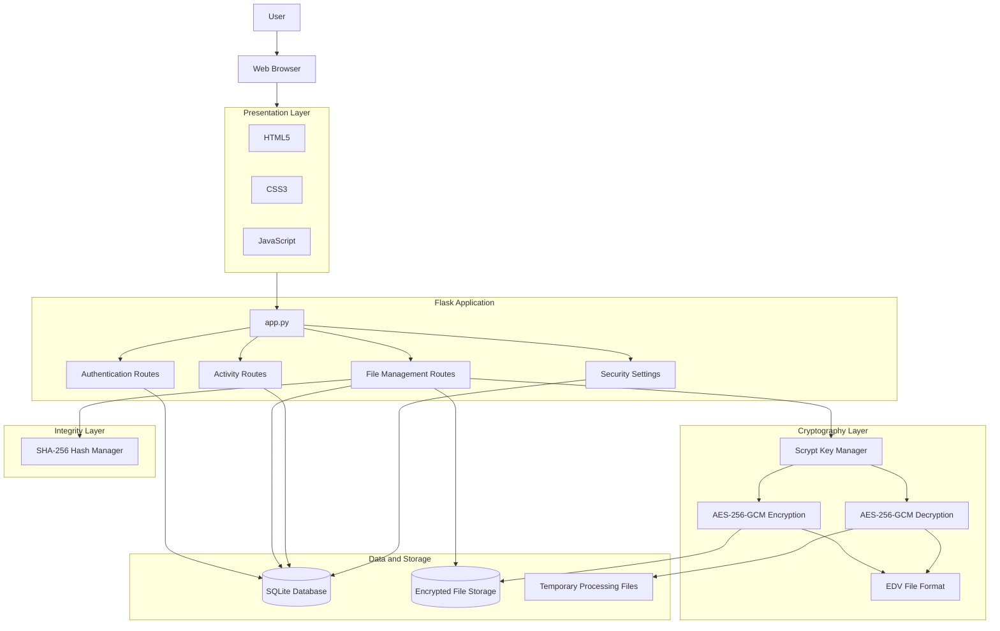
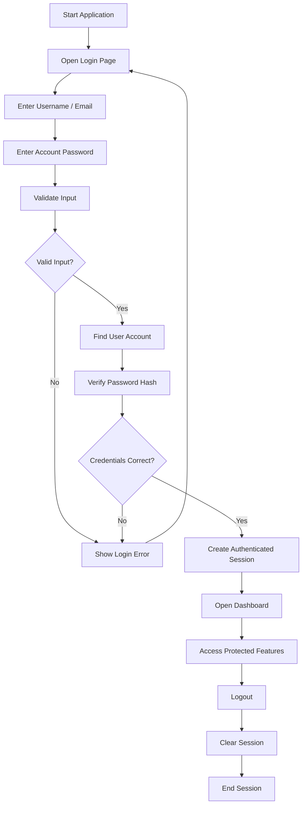
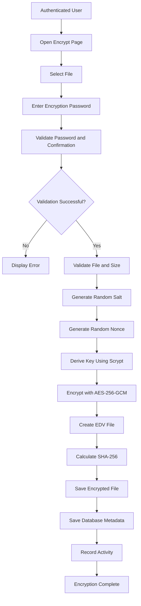
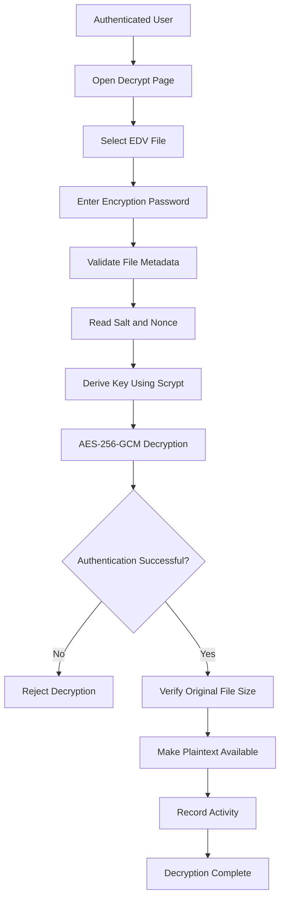
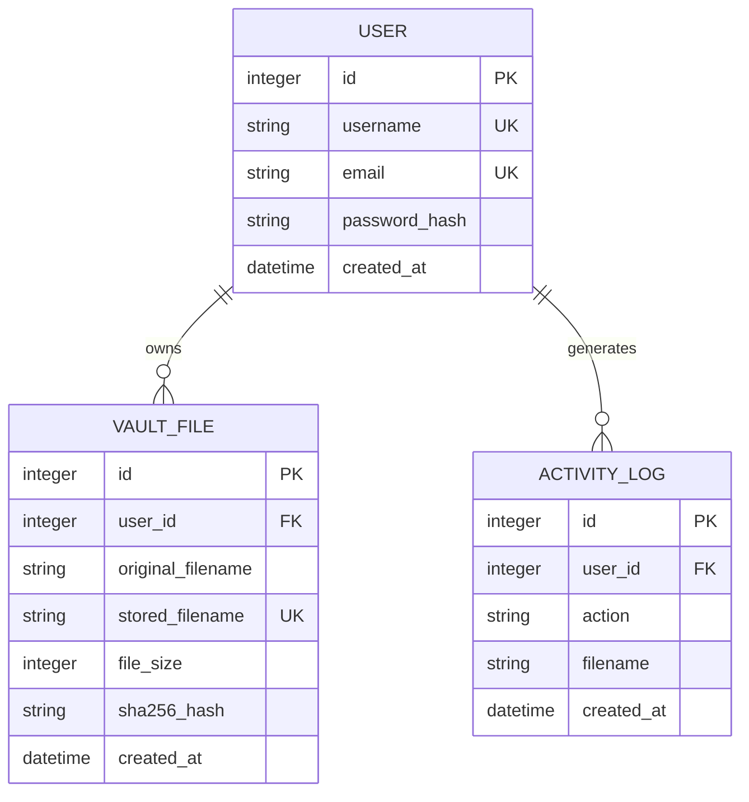
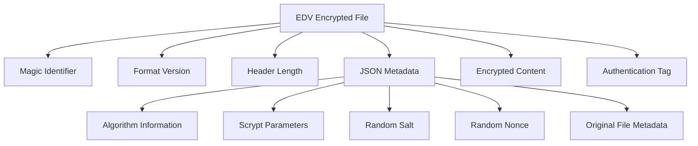
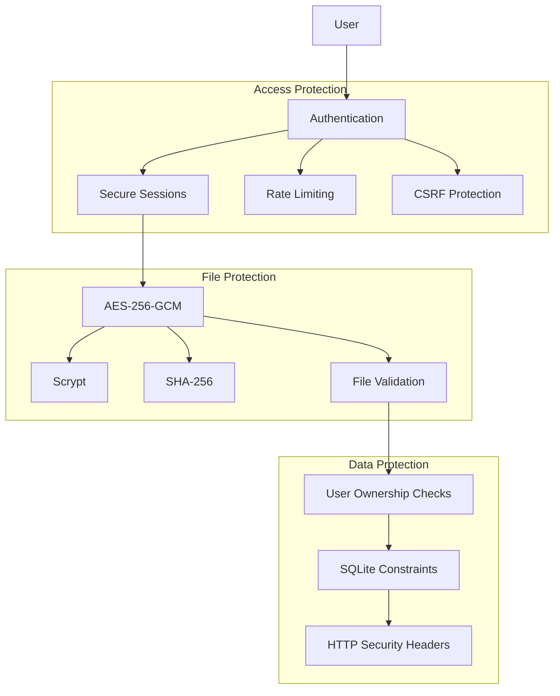

# E/D Vault — System Diagrams

**Project:** Encryption and Decryption Vault  
**Version:** 1.0  
**Category:** Cybersecurity / Cryptography

---

# Diagram 1 — Overall System Architecture

# Diagram 2 — User Authentication Flow

# Diagram 3 — File Encryption Workflow

# Diagram 4 — File Decryption Workflow

# Diagram 5 — Database Entity Relationship Diagram

# Diagram 6 — Encrypted File Structure

# Diagram 7 — Security Architecture

---

# Diagram Summary

| Diagram | Purpose |
|---|---|
| 1. System Architecture | Explains overall application structure |
| 2. Authentication Flow | Explains account login and logout |
| 3. Encryption Workflow | Explains file encryption |
| 4. Decryption Workflow | Explains file restoration |
| 5. ER Diagram | Explains database relationships |
| 6. EDV File Structure | Explains encrypted file components |
| 7. Security Architecture | Explains security controls |

---

**E/D Vault — Secure Your Files. Protect Your Privacy.**