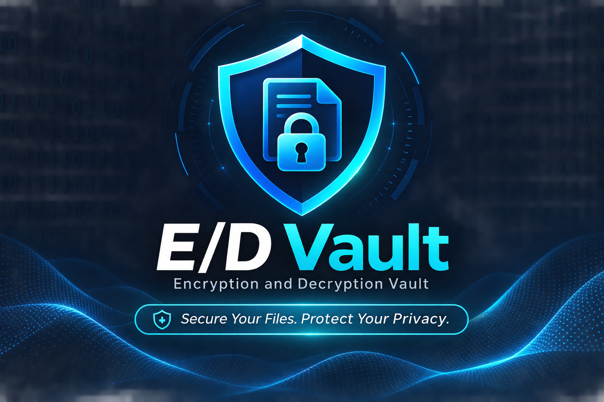

# E/D Vault 🔐
### Encryption and Decryption Vault

<p align="center">
  
</p>

<p align="center">
  **Secure Your Files. Protect Your Privacy.**
</p>

<p align="center">
  A personal cybersecurity project focused on file encryption, decryption, cryptography, and data protection.
</p>

---

## 🚀 Project Overview

E/D Vault is a Python-based cybersecurity web application designed to protect sensitive files through strong encryption and secure file management.

It uses **AES-256-GCM encryption**, **Scrypt key derivation**, and **SHA-256 integrity verification** to help protect files against unauthorized access and tampering.

## 🛡️ Security Technologies

| Technology | Purpose |
|---|---|
| AES-256-GCM | Authenticated file encryption |
| Scrypt | Password-based key derivation |
| SHA-256 | File integrity verification |
| Werkzeug | Account password hashing |
| Flask-Limiter | Login and request rate limiting |
| Flask-WTF | CSRF protection |
| Secure Sessions | Session and cookie security |
| SQLite | Application database |

## ⚙️ Technology Stack

**Backend:** Python, Flask, Flask-SQLAlchemy, SQLite

**Frontend:** HTML5, CSS3, JavaScript

**Cryptography:** PyCA Cryptography, AES-256-GCM, Scrypt, SHA-256

## ✨ Core Features

### 1. User Authentication
- User registration and login.
- Password hashing.
- Login rate limiting.
- Session protection.

### 2. File Encryption
- Upload files through the web interface.
- AES-256-GCM encryption.
- Random salt and nonce generation.
- Password-derived encryption keys.
- Encrypted `.edv` file format.

### 3. File Decryption
- Password-based decryption.
- Authentication tag verification.
- Wrong-password detection.
- Protection against corrupted encrypted files.

### 4. Personal Vault
- View encrypted files.
- Download encrypted files.
- Delete stored files.
- Per-user file access restrictions.

### 5. Integrity Verification
- SHA-256 hash calculation.
- Verification of encrypted file integrity.
- Detection of file modifications when a trusted baseline exists.

### 6. Activity History
- Track file-related activities.
- View recent activity.
- Search and filter activity records.

### 7. Security Controls
- CSRF protection.
- Upload validation and file size restrictions.
- Security response headers.
- Account and file access controls.

## 🔄 How It Works

**Encryption workflow**

1. User selects a file.
2. User enters an encryption password.
3. A random salt and nonce are generated.
4. Scrypt derives an encryption key.
5. AES-256-GCM encrypts the file.
6. The encrypted output is saved in `.edv` format.
7. SHA-256 integrity information is recorded.

**Decryption workflow**

1. User selects an encrypted `.edv` file.
2. User enters the encryption password.
3. The application reads the encryption metadata.
4. Scrypt derives the encryption key.
5. AES-256-GCM verifies and decrypts the data.
6. The decrypted file becomes available only after successful authentication.

## 🏗️ System Architecture and Diagrams

The project includes diagrams explaining its architecture and security workflows.

See **[DIAGRAMS.md](DIAGRAMS.md)** for:

- Overall system architecture.
- User authentication flow.
- File encryption workflow.
- File decryption workflow.
- Database ER diagram.
- Encrypted file structure.
- Security architecture.

## 📁 Project Structure

```text
E_D Vault/
│
├── app.py
├── config.py
├── extensions.py
├── migrate_integrity.py
│
├── authentication/
├── database/
├── encryption/
├── integrity/
├── routes/
├── templates/
├── tests/
├── sample_files/
├── assets/
│   └── ed-vault-banner.png
│
├── README.md
├── DIAGRAMS.md
├── PROJECT_DOCUMENTATION.md
├── SYSTEM_ARCHITECTURE.md
├── SECURITY_DOCUMENTATION.md
├── TESTING_REPORT.md
├── requirements.txt
└── .gitignore
```

## 💻 Installation and Setup

### Prerequisites
- Python 3.10 or newer.
- pip.
- Git.

### 1. Clone the repository

```bash
git clone https://github.com/inkmathur/E-D-Vault.git
cd E-D-Vault
```

### 2. Create a virtual environment

```bash
python -m venv venv
```

### 3. Activate the environment

Windows PowerShell:

```powershell
.\venv\Scripts\Activate.ps1
```

### 4. Install dependencies

```bash
pip install -r requirements.txt
```

### 5. Configure environment variables

Create a `.env` file in the project root.

```env
SECRET_KEY=YOUR_RANDOM_SECRET_KEY
SESSION_COOKIE_SECURE=false
```

Generate a strong random secret key. Never publish your real `.env` file.

For a local HTTP development environment, `SESSION_COOKIE_SECURE=false` is appropriate. Use HTTPS and enable secure cookies in production.

### 6. Run the application

```bash
python app.py
```

Open the local address shown by Flask in your browser.

## 🧪 Testing

Run the automated test suite:

```bash
python -m unittest discover -s tests -v
```

The project includes tests for:

- Encryption and decryption.
- Key generation and Scrypt.
- Encrypted file format validation.
- File integrity verification.
- Overwrite protection.
- Database security.
- HTTP security headers.

## 📚 Project Documentation

| Document | Description |
|---|---|
| [Project Documentation](PROJECT_DOCUMENTATION.md) | Complete technical project overview |
| [System Architecture](SYSTEM_ARCHITECTURE.md) | Architecture and workflows |
| [Security Documentation](SECURITY_DOCUMENTATION.md) | Security controls and threat model |
| [Testing Report](TESTING_REPORT.md) | Testing approach and reported results |
| [Diagrams](DIAGRAMS.md) | System and database diagrams |

## ⚠️ Current Limitations

- The current encryption prototype supports files up to 100 MB.
- File encryption and decryption currently use whole-file memory processing.
- Authenticated chunk-based encryption is a future improvement for larger files.
- The application is currently designed as a local development prototype, not a production-hosted security service.
- Existing encrypted files without a saved integrity baseline cannot receive historical SHA-256 verification.

## 🔮 Future Improvements

- Authenticated chunk-based encryption for large files.
- Multi-factor authentication.
- Password recovery and account recovery workflows.
- Improved key management.
- Secure cloud storage integration.
- Advanced security monitoring.
- Deployment with HTTPS and production-grade rate-limit storage.
- Automated security testing.

## 👨‍💻 Project Information

| Detail | Information |
|---|---|
| Project Name | E/D Vault |
| Full Name | Encryption and Decryption Vault |
| Category | Cybersecurity / Cryptography |
| Version | 1.0 |
| Project Type | Personal Project |
| Primary Language | Python |

---

<p align="center">
  **🔐 Secure Your Files. Protect Your Privacy.**
</p>

<p align="center">
  Built as a personal cybersecurity project to explore practical cryptography, secure file handling, and data protection.
</p>