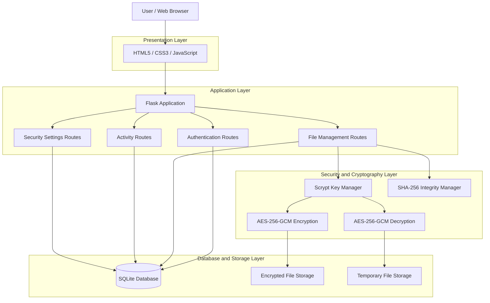
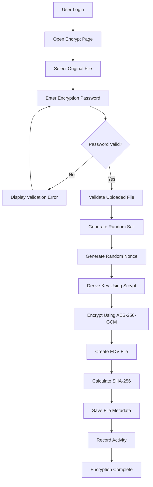
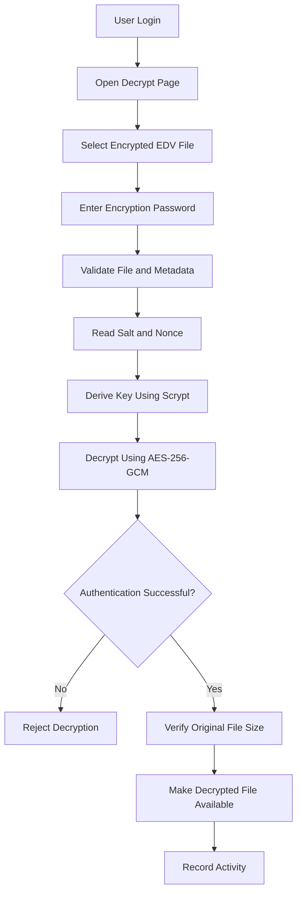
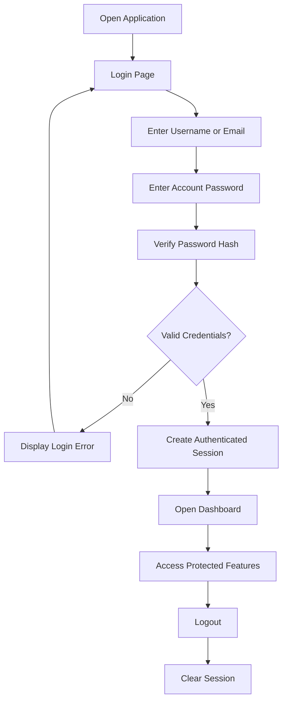
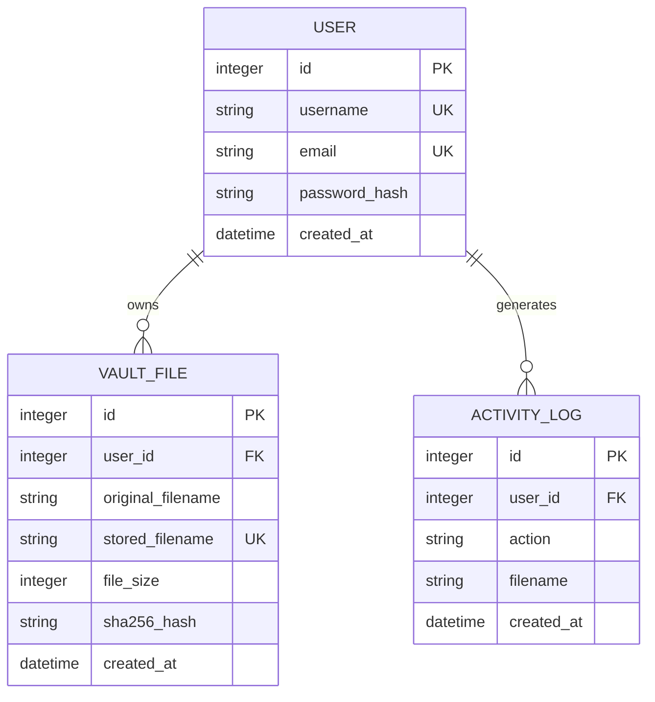

# E/D Vault — System Architecture

**Project:** Encryption and Decryption Vault  
**Version:** 1.0  
**Category:** Cybersecurity / Cryptography

---

# 1. Architecture Overview

E/D Vault follows a modular web application architecture.

The system is divided into six major layers:

1. Presentation Layer
2. Application Layer
3. Authentication Layer
4. Cryptography Layer
5. Integrity Layer
6. Database and Storage Layer

Each layer performs a specific responsibility and communicates with other layers through defined application interfaces.

# 2. High-Level System Architecture



# 3. Component Description

## 3.1 Presentation Layer

The presentation layer provides the user interface.

Technologies:

- HTML5
- CSS3
- JavaScript

Responsibilities:

- Display login and registration pages.
- Provide file upload forms.
- Display the dashboard.
- Manage vault interactions.
- Display activity history.
- Display security settings.

## 3.2 Application Layer

The Flask application handles incoming requests and coordinates system operations.

Main components:

| Component | Responsibility |
|---|---|
| app.py | Application initialization |
| authentication/routes.py | User authentication |
| routes/files.py | File operations |
| routes/activity.py | Activity history |
| routes/settings.py | Account security settings |

## 3.3 Cryptography Layer

This layer protects file contents.

It contains:

- `key_manager.py`
- `file_format.py`
- `encrypt.py`
- `decrypt.py`

Its primary responsibilities are key derivation, encryption, encrypted file formatting, and authenticated decryption.

## 3.4 Integrity Layer

The integrity layer contains:

`integrity/hash_manager.py`

It calculates and verifies SHA-256 hashes of files.

## 3.5 Database Layer

The database layer uses SQLite and Flask-SQLAlchemy.

It stores:

- User information.
- Encrypted file metadata.
- File integrity hashes.
- Activity records.

## 3.6 Storage Layer

The storage layer holds encrypted files and temporary processing files.

Encrypted files are stored separately from database metadata.

Temporary plaintext files are used during appropriate file-processing operations and should be cleaned up after use.

# 4. Encryption Workflow

The encryption workflow converts an original file into an encrypted `.edv` file.



## Encryption Explanation

**Step 1:** The user authenticates and selects a file.

**Step 2:** The application validates the filename and upload size.

**Step 3:** A random salt and nonce are generated.

**Step 4:** Scrypt derives a 256-bit encryption key from the password and salt.

**Step 5:** AES-256-GCM encrypts the file and authenticates the associated metadata.

**Step 6:** The encrypted output is saved with the `.edv` extension.

**Step 7:** SHA-256 is calculated and stored as an integrity baseline.

# 5. Decryption Workflow

The decryption workflow converts an encrypted `.edv` file back into its original content.



## Decryption Explanation

1. The user selects an encrypted file.
2. The application reads and validates the encrypted file format.
3. Scrypt derives the encryption key using the supplied password.
4. AES-256-GCM authenticates and decrypts the encrypted content.
5. If authentication fails, decryption is rejected.
6. If authentication succeeds, the original file is made available.

# 6. User Authentication Workflow



# 7. Database Entity Relationship Diagram



# 8. Encrypted File Structure

The `.edv` file uses a custom binary format.

Its logical structure is:

```text
+----------------------------------+
| Magic Identifier                 |
+----------------------------------+
| Format Version                   |
+----------------------------------+
| Header Length                    |
+----------------------------------+
| JSON Encryption Metadata         |
|                                  |
| - Algorithm Information          |
| - Scrypt Parameters               |
| - Random Salt                     |
| - Random Nonce                    |
| - Original File Metadata          |
+----------------------------------+
| Encrypted File Content            |
+----------------------------------+
| AES-GCM Authentication Tag        |
+----------------------------------+
```

The exact binary encoding and header layout are defined in `encryption/file_format.py`.

# 9. Security Architecture

E/D Vault implements multiple security controls.

| Security Control | Purpose |
|---|---|
| AES-256-GCM | File confidentiality and authentication |
| Scrypt | Password-based key derivation |
| Random Salt | Prevents identical password-derived keys across different salts |
| Random Nonce | Provides unique encryption operation input |
| SHA-256 | Detects changes relative to a stored baseline |
| Werkzeug Hashing | Protects account passwords |
| CSRF Protection | Protects state-changing forms |
| Rate Limiting | Limits repeated requests |
| Session Security | Protects authenticated sessions |
| Ownership Validation | Restricts access to each user's files |
| Secure File Validation | Reduces unsafe file handling |
| HTTP Security Headers | Adds browser-side protections |

# 10. Data Flow

The main data flow is:

**User → Browser → Flask → Security Modules → Database / File Storage → Browser**

During encryption:

- Original file is processed by the encryption module.
- Encrypted content is saved in file storage.
- File metadata and SHA-256 baseline are saved in SQLite.

During decryption:

- Encrypted content is read from storage.
- The cryptographic module authenticates and decrypts it.
- The decrypted result is made available to the user.

# 11. Design Considerations

The architecture uses separate modules to improve code organization and maintainability.

The encryption engine is separated from Flask routes, allowing cryptographic functions to be tested independently.

The database stores file metadata rather than encryption passwords or raw encryption keys.

The current prototype processes complete files in memory and supports files up to approximately 100 MB. Authenticated chunk-based encryption is a planned improvement for larger files.

# 12. Conclusion

The E/D Vault architecture combines web application development, cryptography, database management, and secure file handling.

Its modular structure makes it easier to maintain, test, and extend the system.

The architecture provides a foundation for future improvements such as large-file encryption, multi-factor authentication, and production deployment.

---

**E/D Vault — Secure Your Files. Protect Your Privacy.**